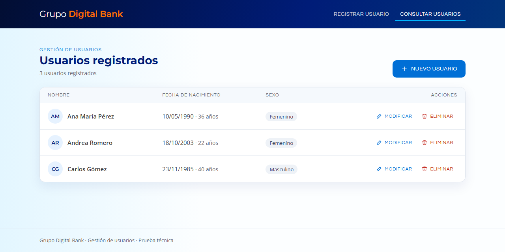
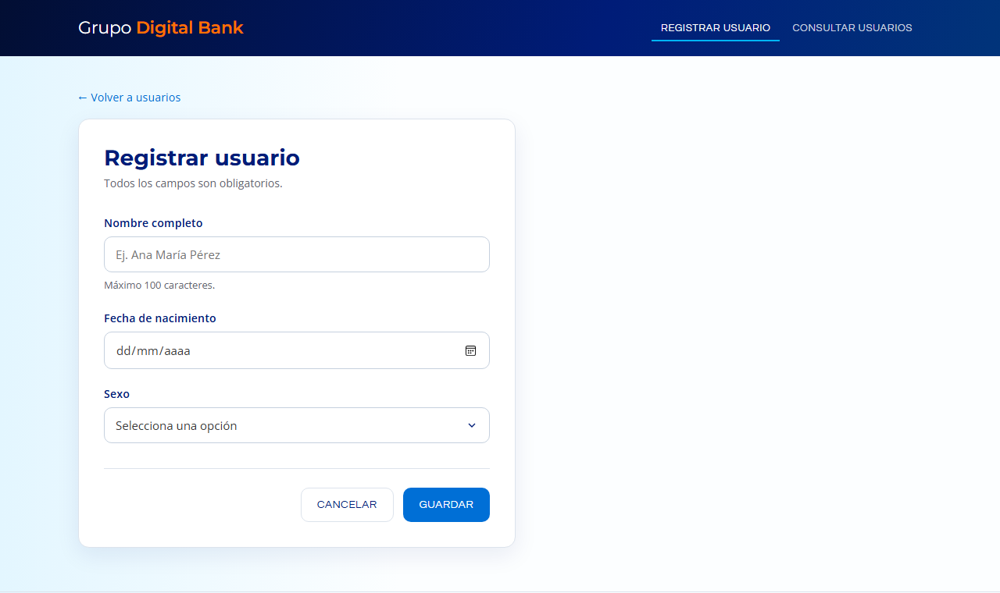
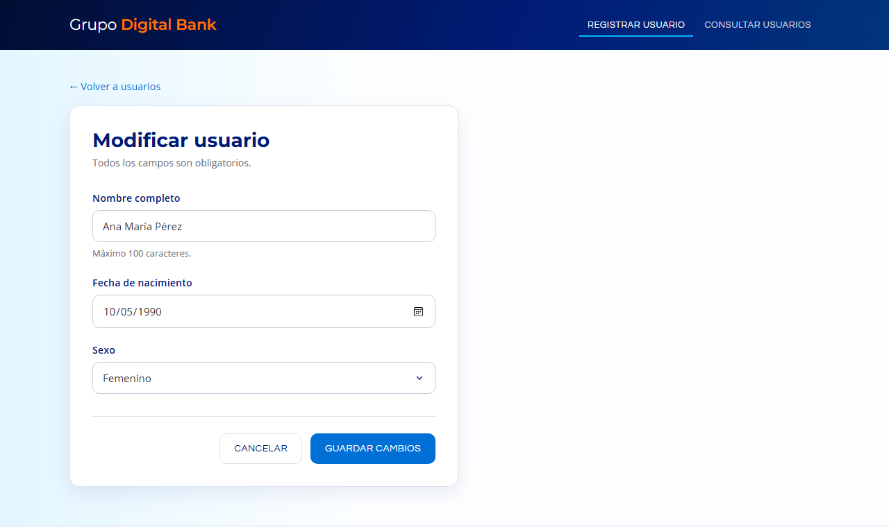
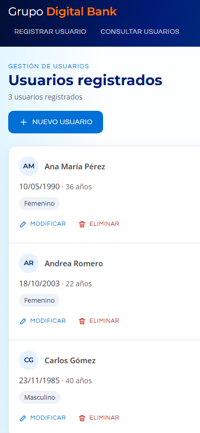

# Sistema de Usuarios por Capas – Prueba Técnica Grupo Digital Bank

CRUD de usuarios con arquitectura en tres capas:
**ASP.NET Web Forms → Servicio WCF (SOAP/HTTP) → SQL Server** (ADO.NET + procedimiento almacenado).



## Arquitectura

```
GDB.Usuarios.Web  ──SOAP (basicHttpBinding)──▶  GDB.Usuarios.Servicio  ──ADO.NET──▶  SQL Server
 Usuario.aspx                                    UsuarioService.svc                   dbo.sp_Usuario_CRUD
 UsuarioConsulta.aspx                            Negocio / Datos                      dbo.Usuario
        └──────────── ambos dependen de ──▶ GDB.Usuarios.Contratos (IUsuarioService, Usuario)
```

| Capa | Proyecto | Responsabilidad |
| --- | --- | --- |
| Presentación | `GDB.Usuarios.Web` | Páginas "usuario" y "usuario consulta". Solo conoce el contrato del servicio |
| Contrato | `GDB.Usuarios.Contratos` | `IUsuarioService` y la entidad `Usuario` que viaja por SOAP |
| Negocios | `GDB.Usuarios.Servicio` | Servicio WCF: valida las reglas y es el único con acceso a la base de datos |
| Datos | `BaseDatos/` | Tabla `dbo.Usuario` y procedimiento `dbo.sp_Usuario_CRUD` |
| Pruebas | `GDB.Usuarios.Servicio.Tests` | Pruebas unitarias de las reglas de negocio (MSTest) |

## Requisitos

- Visual Studio 2022 con la carga **ASP.NET y desarrollo web** y el componente **Windows Communication Foundation**
- SQL Server 2016 o superior, o SQL Server Express LocalDB (incluido con Visual Studio)

## Cómo ejecutar

1. Clonar el repositorio: `git clone https://github.com/davidguasca/GrupoDB.PruebaTecnica.git`
2. Ejecutar en orden los scripts de `BaseDatos/` (01 a 04) sobre `(localdb)\MSSQLLocalDB`.
3. Si se usa otra instancia, ajustar la cadena `BDUsuarios` en `GDB.Usuarios.Servicio/Web.config`.
4. Abrir `GrupoDigitalBank.PruebaTecnica.sln`.
5. Solución → **Configurar proyectos de inicio** → **Varios proyectos de inicio**: `GDB.Usuarios.Servicio` y `GDB.Usuarios.Web` en *Iniciar*.
6. F5. Servicio en `http://localhost:5100/`, web en `http://localhost:5200/`.

Pruebas unitarias: **Prueba → Ejecutar todas las pruebas**.

## Decisiones de diseño

| Decisión | Motivo |
| --- | --- |
| `Id` identity como llave primaria | El enunciado no lo pide, pero sin llave no se puede modificar ni eliminar sin ambigüedad |
| `NVARCHAR(100)` y `CHAR(1)` con `CHECK` | Unicode para tildes y ñ; la base garantiza que el sexo sea M o F |
| Un procedimiento con `@Accion` (C, R, U, D) | Cumple "un procedimiento CRUD" y es la única puerta de entrada a la tabla |
| Contrato en un ensamblado propio, consumido con `ChannelFactory` | La web depende de la interfaz y no de la implementación. Un cambio de contrato rompe la compilación en lugar de fallar en ejecución, y no hay proxy generado que mantener |
| `Consultar(int? id)` | Un método para "todos" o "uno"; WCF no admite sobrecarga de operaciones |
| Validación en navegador, servicio y base | Experiencia de usuario, seguridad e integridad, respectivamente |
| Errores de negocio como `FaultException` | El cliente recibe mensajes claros; los detalles técnicos se registran en el servidor |
| Canal WCF con `Close` / `Abort` | Con `using`, `Dispose` ocultaría la excepción original si el canal falla |
| `TextMode="Date"` | Calendario nativo del navegador, con navegación rápida por año |
| Puertos 5100 y 5200 | Fuera del rango dinámico de Windows (49152+), que Hyper-V/WSL pueden reservar |
| `minFreeMemoryPercentageToActivateService="0"` | WCF no activa servicios con menos de 5 % de RAM libre; en desarrollo se desactiva ese umbral |

## Interfaz

Alineada con la identidad de [grupodigitalbank.com](https://grupodigitalbank.com/): azul noche `#001C78`, naranja de marca `#FF7201` y acento cian `#00B6FF`, con las tipografías Montserrat, Questrial y Open Sans. CSS y JavaScript propios, sin frameworks.

- **Accesibilidad:** contraste AA (el azul de los botones se ajustó de `#007EDE` a `#006FD6`), foco visible, etiquetas asociadas a cada campo y avisos anunciados a lectores de pantalla.
- **Retroalimentación:** avisos de éxito y error, el campo con error se marca en rojo y el botón se bloquea durante el envío para evitar registros duplicados.
- **Eliminación segura:** diálogo de confirmación que nombra al usuario.
- **Adaptable:** en pantallas pequeñas la grilla se convierte en tarjetas apiladas.

## Cumplimiento de requisitos

| Requisito | Dónde se cumple |
| --- | --- |
| Página "usuario" con caja de texto, calendario y DropDownList | `GDB.Usuarios.Web/Usuario.aspx` |
| Página "usuario consulta" con grilla, Modificar y Eliminar | `GDB.Usuarios.Web/UsuarioConsulta.aspx` |
| Servicio WCF con Agregar, Modificar, Consultar y Eliminar | `GDB.Usuarios.Contratos/IUsuarioService.cs`, implementado en `GDB.Usuarios.Servicio/UsuarioService.svc.cs` |
| Conexión a la base de datos desde la capa de negocios | `GDB.Usuarios.Servicio/Datos/UsuarioRepositorio.cs` y su `Web.config` |
| Tabla con Nombre (100), Fecha de nacimiento y Sexo (1) | `BaseDatos/02_CrearTablaUsuario.sql` |
| Procedimiento almacenado CRUD | `BaseDatos/03_sp_Usuario_CRUD.sql` |
| Desarrollado en .NET | .NET Framework 4.8, C# |

## Capturas

| Registrar | Modificar |
| --- | --- |
|  |  |



## Mejoras para producción

- HTTPS y autenticación en el servicio; usuario de base de datos con permiso solo de `EXECUTE` sobre el procedimiento
- Inyección de dependencias del repositorio para probar el servicio sin base de datos
- Concurrencia optimista con `rowversion`
- Logging estructurado y paginación en servidor
- Migración a .NET 8 con CoreWCF o ASP.NET Core Web API

## Autor

**David Guasca** · [github.com/davidguasca](https://github.com/davidguasca)
